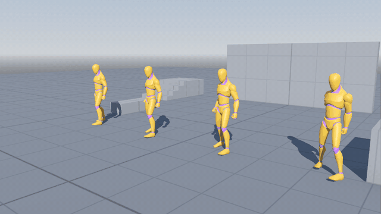
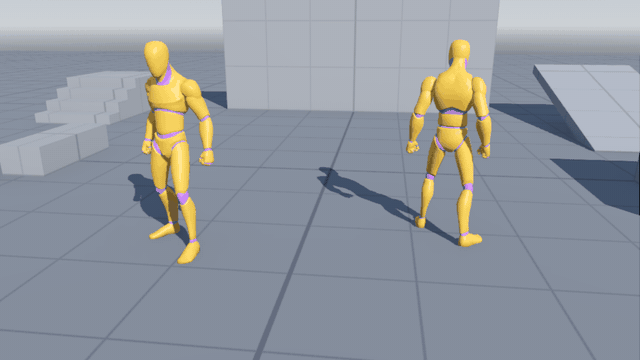

# Active Ragdoll for Godot 4



Active ragdolls for humanoid `Skeleton3D`s. Physical bones are driven by muscles towards the animated pose, so
bodies react to hits, stumble, fall, lie on the ground and get up instead of just going limp.

- Puppet mode: the body is always physical, the animation is the target. Hits push the struck part, heavy ones make
  the character stumble and step to catch itself, or fall.
- Knock-downs from the hit point: the struck part goes first and the body topples over its feet.
- Falling alive: arms reach for the ground, the head is protected. Death: legs give out first.
- Lying hurt: the body moves, holds the wound, then gets up from where it lies (from the back or onto hands and
  knees).
- Hit reactions and stagger on plain animation, a procedural crawl, self-collision, no rubber stretching.

Godot 4.4+, Jolt or Godot Physics.



## Install

Copy `addons/active_ragdoll` into your project's `addons/`. Enabling the plugin is optional, the classes are global.

## Demo

The repository is a Godot project, open it and press F5. Click a mannequin to shoot, shove, kill or knock it down
(1–4, power slider). WASD walks, Q throws a crate, C crawl, R get up, P puppet mode, T slow motion, B shows the
physical bodies.

`demo/tools/` has headless checks (`demo_check.gd`) and probes for each behaviour. The demo isn't included in the
addon download.

Mannequin and animations: [Quaternius Universal Animation Library](https://quaternius.com/packs/universalanimationlibrary.html)
1 and 2 (CC0). The face-down get-up is built from key poses in `demo/getup_front.gd`.

## Usage

```gdscript
# Skeleton retargeted to SkeletonProfileHumanoid bone names (import with a BoneMap).
var ragdoll := ActiveRagdoll.create($Skeleton3D, RagdollProfile.humanoid())
ragdoll.collision_layer = 1 << 9   # own layer, not in the mask
ragdoll.collision_mask = 1         # world

# Puppet mode
ragdoll.puppet(true)
ragdoll.puppet_hit(&"LeftUpperArm", dir * 12.0)
ragdoll.balance_lost.connect(func(): ragdoll.release("fall"))
# while ragdoll.stumbling(): move the character at ragdoll.stumble_velocity()

# Knocked down / killed
ragdoll.knock(&"UpperChest", dir * 150.0, "fall", velocity)
ragdoll.knock(&"Head", dir * 20.0, "die", velocity)

# On the ground
ragdoll.settled.connect(func(): ragdoll.writhe())

# Getting up: place the character on the lying body, play the clip, let the body follow it
var clip := anim.get_animation("GetUp")
character.global_transform = ragdoll.get_up_transform(character, ActiveRagdoll.clip_pose(skeleton, clip, "Hips"))
anim.play("GetUp")
ragdoll.get_up(clip.length)

# Without puppet mode
ragdoll.hit(&"LeftUpperArm", dir * 7.0)       # upper body reacts, legs keep animating
ragdoll.stagger(&"UpperChest", dir * 12.0)    # step at ragdoll.stagger_velocity() while staggering()
```

See `demo/character.gd` for a complete character.

## How it works

Each physical bone has a muscle: a velocity motor that turns it relative to its physical parent towards the target
pose, giving the parent the opposite change, so momentum is kept. Torque springs are unstable on light bodies at game
tick rates and tear the joints apart. In puppet mode pins also pull bodies towards their animated place (the upper
body relative to the hips, the hips and feet in the world). Behaviours change muscle tone, pins and targets.

## API

`ActiveRagdoll`:

| | |
|---|---|
| `create(skeleton, profile)` | build bodies and modifiers |
| `start(v)`, `stop()`, `is_running()` | whole-body ragdoll on / off |
| `collapse()`, `fall()` | death, alive fall (call after `start`) |
| `knock(bone, impulse, how, v)` | knocked down by a blow, from any mode |
| `hit(bone, impulse)` | upper-body hit reaction on plain animation |
| `stagger(bone, impulse)`, `staggering()`, `stagger_velocity()` | blow that may knock over, without puppet mode |
| `puppet(on)`, `puppet_hit(bone, impulse, unpin, balance)`, `release(how)` | puppet mode |
| `drift()`, `stumbling()`, `stumble_velocity()` | where the feet should go |
| `writhe()`, `writhing()` | hurt on the ground |
| `lying_on_back()`, `lying_face_down()`, `roll_over()` | lying |
| `get_up_transform()`, `clip_pose()`, `get_up(duration)` | getting up along a clip |
| `add_crawl_modifier()` | procedural crawl (`CrawlModifier`) |
| signals `settled`, `balance_lost`, `recovered` | |

Most numbers are exported on the node (pins, stumbling, muscle stiffness, `max_arm_twist`, `writhe_time` …).

`RagdollProfile.humanoid()` gives 15 bodies, 75 kg. Each bone: capsule `to`/`radius`, `mass`, `joint` (cone or
hinge) and `limits`, `group`, optional `hang` (centre the limits on a hanging arm for T-pose rigs). Fit the radii to
your mesh, see `MANNEQUIN_RADII` in the demo.

## Tips

- If knees or elbows bend the wrong way, flip `knee_sign` / `elbow_sign` in the profile.
- Puppet mode costs the most. Switch it off for characters far away.

## License

MIT © 2026 Danil Khmyrov, see [`LICENSE`](addons/active_ragdoll/LICENSE).
