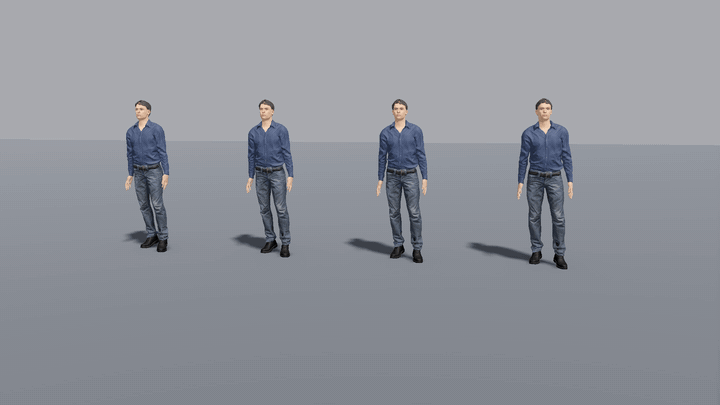

# Active Ragdoll for Godot 4



Powered ragdolls for humanoid `Skeleton3D`s: physical bones driven by **PD muscles**
that pull them towards the animated pose. Instead of a body that goes limp like a puppet
with its strings cut, you get:

- **puppet mode** (PuppetMaster / Euphoria style) — the body is physical all the time and the
  animation is only its target: muscles pull joints to the animated pose, pins pull bodies to their
  animated place (feet hard — they carry the body, hands soft — they deflect off obstacles). A hit
  weakens pins and muscles of the struck part — it really flies off, collides with the rest of the
  body and is pulled back; a heavy blow loosens the hips, the body sways, your locomotion reads
  `drift()` to step under it, and past `balance_max_drift` / `balance_max_drop` it emits
  `balance_lost` — `release()` lets it fall carrying the motion it already had;
- **collapse** — on death the pose holds for a moment, then muscles give out by group:
  legs first (knees buckle), spine and head next, arms last;
- **fall** — an alive body keeps some tone; falling forwards it **braces with its arms**,
  falling backwards it **tucks its chin** and brings its arms in;
- **hit** — a blow without falling: only the upper body simulates while the legs keep
  animating, and muscles pull it back to the animation; it hands control back to the
  animation by itself, blending smoothly;
- **stagger** — a blow that may knock the body over: the torso sways like an inverted pendulum
  and `stagger_velocity()` tells your locomotion where to step to get the feet under it; caught
  it — `recovered`, didn't — `balance_lost` (knock the body over);
- **self-collision** — limbs collide with each other and with the torso (no arm through the chest),
  neighbours on the chain and parts overlapping at the start pose are excepted automatically;
- **crawl** — `CrawlModifier`: a procedural prone crawl (arms reach and pull in turns, legs drag,
  one can be limp); in puppet mode the physical body follows it and really touches the ground;
- **no rubber stretching** — `BoneLengthGuard` keeps bone lengths on screen even when the
  solver lets joints separate for a frame (hard hits, walls).

Works with Jolt and Godot Physics, Godot 4.4+ (uses `PhysicalBoneSimulator3D` and
`SkeletonModifier3D`).

## Install

Copy the `addons/active_ragdoll` folder from this repository into your project's `addons/`.
Enabling the plugin is optional: the classes are global (`class_name`).

## Quick start

```gdscript
# Your character's skeleton, retargeted to SkeletonProfileHumanoid bone names
# (import the model with a BoneMap — "Hips", "Spine", "LeftUpperArm", …).
var ragdoll := ActiveRagdoll.create($Skeleton3D, RagdollProfile.humanoid())
ragdoll.collision_layer = 1 << 9          # a layer the bodies don't collide with themselves
ragdoll.collision_mask = 1                # the world

# Killed by a shot:
ragdoll.start(velocity + shot_dir * 2.0)
ragdoll.collapse()

# Puppet mode (always physical, animation is the target):
ragdoll.puppet(true)
ragdoll.puppet_hit(&"LeftUpperArm", shot_dir * 12.0)     # the arm flies off and comes back
ragdoll.balance_lost.connect(func(): ragdoll.release("fall"))
# killed: ragdoll.release("die", shot_dir * 0.5)

# Knocked over, alive:
ragdoll.start(push_velocity)
ragdoll.fall()

# Shot in the arm, stays on his feet:
ragdoll.hit(&"LeftUpperArm", shot_dir * 7.0)

# Shot in the chest — staggers back, maybe falls:
ragdoll.stagger(&"UpperChest", shot_dir * 12.0)
ragdoll.balance_lost.connect(func(): ragdoll.start(velocity); ragdoll.fall())
# every physics tick while ragdoll.staggering(): move your character at ragdoll.stagger_velocity()
# with the walk/run animation in that direction — those are the steps

# Wounded, crawling away (puppet mode on):
var crawl := ragdoll.add_crawl_modifier()
crawl.limp_leg = "Left"
crawl.weight = 1.0
# every frame: move the character forward by crawl.pull() * ~0.25 m per cycle

# Lying still — play a get-up animation:
ragdoll.settled.connect(func(): ragdoll.stop())
```

## How it works

Each physical bone has a muscle. Every physics tick it compares the bone's rotation **relative
to its physical parent** with the target pose and pulls the bone's angular velocity towards
"the parent's + a correction of the error" (a velocity motor); the parent gets the opposite change
scaled by inertia, so momentum is kept and a ragdoll cannot push itself through the air. A torque
spring would be the textbook choice, but on a light body that carries a lot (a vertebra under the
whole upper body) it is unstable at game tick rates — it spins the body in one tick and tears the
joints apart: the classic "ragdoll stretches like rubber" bug.

Stagger does not simulate bones at all: the torso is an inverted pendulum (the blow gives it a
lean velocity from `(r × impulse) / inertia`, its weight topples it, muscles and support from
stepping bring it back), and `LeanModifier` tilts the spine on top of the animation.

The target is either the **live animation** (outside the skeleton's modifier update its pose
is the animated one — `SkeletonModifier3D` changes are temporary) or a **snapshot** taken when
the ragdoll started. Muscle tone per bone (`tone`, 0..1) is what behaviours animate.

## API

`ActiveRagdoll` (Node):

| | |
|---|---|
| `static create(skeleton, profile)` | build bodies from a profile, add the node and a `BoneLengthGuard` |
| `setup(skeleton, simulator, bones)` | use bodies you built yourself (`{name: PhysicalBone3D}`), then `add_length_guard()` |
| `start(v, spin, exceptions, exception_time)` | whole-body ragdoll from the current pose, flying at `v` |
| `collapse(times, start_tone)` | death: tone fades by group (`{"legs": 0.18, "spine": 0.5, "head": 0.55, "arms": 0.8}`) |
| `fall(start_tone, duration, brace)` | alive fall with bracing / protecting |
| `hit(bone, impulse, recover_tone, max_time)` | upper-body hit reaction on the live animation |
| `stagger(bone, impulse)` | a blow that may knock over; then `staggering()`, `stagger_velocity()`, `lean()` |
| `puppet(on)`, `is_puppet()` | puppet mode |
| `puppet_hit(bone, impulse, unpin, balance)` | weaken the struck part (and the hips' balance) and push it |
| `drift()`, `drop()` | where the hips are vs the animation (step under them) |
| `release(how, dv)` | puppet → falling body ("die", "fall", "limp") |
| `stop()` | stop simulating (before a get-up animation) |
| `is_running()`, `hitting()`, `hips_speed()` | state |
| signal `settled` | the body has come to rest |
| signals `balance_lost`, `recovered` | stagger outcome |

Exports: `pin_rate`, `pin_weights`, `foot_pin`, `root_pin`, `recover_rate`, `balance_max_drift`, `balance_max_drop`, `hit_share`, `spine_brace`, `self_collision`, `frequency`, `damping_ratio`, `max_angular_step`, `collision_layer`, `collision_mask`,
`settle_speed`, `hit_stiffness`, `hit_release`, `stagger_tone`, `stagger_max_lean`,
`stagger_gain`, `stagger_time`, `stagger_power` (how much harder than physics a blow sways — 1 is physical).

`RagdollProfile` (Resource): `bones` — `{bone name: {to, radius, mass, joint, limits, group}}`,
`knee_sign` / `elbow_sign` (hinge direction depends on the rig's bone axes), friction and damping.
`RagdollProfile.humanoid()` — 15 bodies, 75 kg, for SkeletonProfileHumanoid.

`RagdollBuilder.build(skeleton, profile)` — just the bodies (`Result.simulator`, `Result.bones`).

`BoneLengthGuard` (SkeletonModifier3D) — keeps bone lengths while simulating; `create()` adds it
right after the simulator.

`TargetPoseModifier` (SkeletonModifier3D) — records the puppet target (animation + IK) right before the
simulator; `create()` adds it.

`LeanModifier` (SkeletonModifier3D) — tilts the spine by the stagger lean; `create()` adds it right
before the simulator (`add_lean_modifier(spine_bones)` for your own setup).

`CrawlModifier` (SkeletonModifier3D) — procedural prone crawl: `weight`, `speed`, `limp_leg`, `hips_height`,
`pull()`; `add_crawl_modifier()` puts it before the puppet target.

## Tips

- Give the bodies a layer of their own and keep it out of `collision_mask`; `self_collision`
  adds it back with the right exceptions.
- If knees or elbows bend the wrong way on your rig, flip `knee_sign` / `elbow_sign`.
- Hit impulses of 5–10 N·s read as a strong blow; 15+ folds a standing body.

## Cost

Measured headless (logic, animation and physics, no rendering) on an Apple M4: a puppet-mode
character costs ~0.13 ms of CPU per physics frame, a falling ragdoll ~0.09 ms, a lying one ~0.04 ms.
Switch puppet mode off at a distance (plain animation), e.g. beyond ~30 m.

## License

MIT © 2026 Danil Khmyrov — see [`LICENSE`](addons/active_ragdoll/LICENSE).
